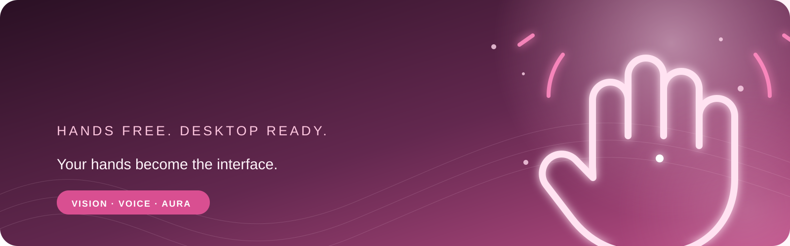

<p align="center">
  
</p>

<h1 align="center">AURA</h1>

<p align="center">
  <strong>Hands-free desktop control with hand gestures and voice</strong><br>
  <sub>A little more magic in your everyday workflow ✨</sub>
</p>

<p align="center">
  
  
  
</p>

<p align="center">
  <a href="https://project-aura-322.netlify.app/">🌷 Live demo</a>
  &nbsp; · &nbsp;
  <a href="#getting-started">Getting started</a>
  &nbsp; · &nbsp;
  <a href="#privacy">Privacy</a>
</p>

---

## 🌸 Overview

AURA is a Windows desktop application that uses a webcam to track hand gestures and offline speech recognition to control common desktop actions. Move the pointer, scroll, click with a pinch, pause or resume control, and launch supported apps by voice.

The [browser demo](https://project-aura-322.netlify.app/) is an interactive preview. Desktop control requires running the Python application locally.

## ✨ Controls

| Gesture or command | Action |
| --- | --- |
| Index finger | Move the pointer |
| Index finger or peace sign | Scroll |
| Pinch | Click |
| “Scroll up” / “Scroll down” | Scroll by voice |
| Hold a fist | Pause controls |
| Hold an open palm | Resume controls |
| “Open [app]” | Launch a matching installed app |
| “Pause AURA” / “Resume AURA” | Pause or resume controls |

Live control starts paused. Resume with an open palm or voice command before using desktop actions.

## 💻 Getting started

Requirements: Windows and Python 3.10 or later.

```powershell
python -m venv .venv
.\.venv\Scripts\Activate.ps1
python -m pip install -r requirements.txt
python aura_controls.py --live
```

Allow camera and microphone access when prompted. Press `P` to pause or resume, and `Q` or `Esc` to quit. Run `python aura_controls.py` without `--live` for a dry run.

### Optional OpenAI voice enhancement

The default voice mode uses offline Vosk. To use OpenAI for phrase transcription and command interpretation, start AURA with `--openai`; enter your key at the hidden terminal prompt, or set `OPENAI_API_KEY` in the current PowerShell session first:

```powershell
python aura_controls.py --live --openai
```

In this mode, detected voice clips and their transcripts are sent to OpenAI. API usage may incur charges. Keep the key local; never commit it or put it in the public website.

## 🔒 Privacy

Hand tracking runs locally. Voice recognition is local by default; `--openai` uploads detected voice clips for cloud transcription and command interpretation. The browser demo is a simulation and does not request camera or microphone access.

## 📁 Project files

- `aura_controls.py` — desktop controls and safety behavior
- `main.py` — hand tracking and gesture recognition
- `voice_control.py` — offline voice commands and app launching
- `docs/` — static browser demo

## License

The AURA source code is licensed under the MIT License. See [LICENSE](LICENSE). The bundled Vosk model is licensed under Apache-2.0; see [third-party notices](THIRD_PARTY_NOTICES.md).
